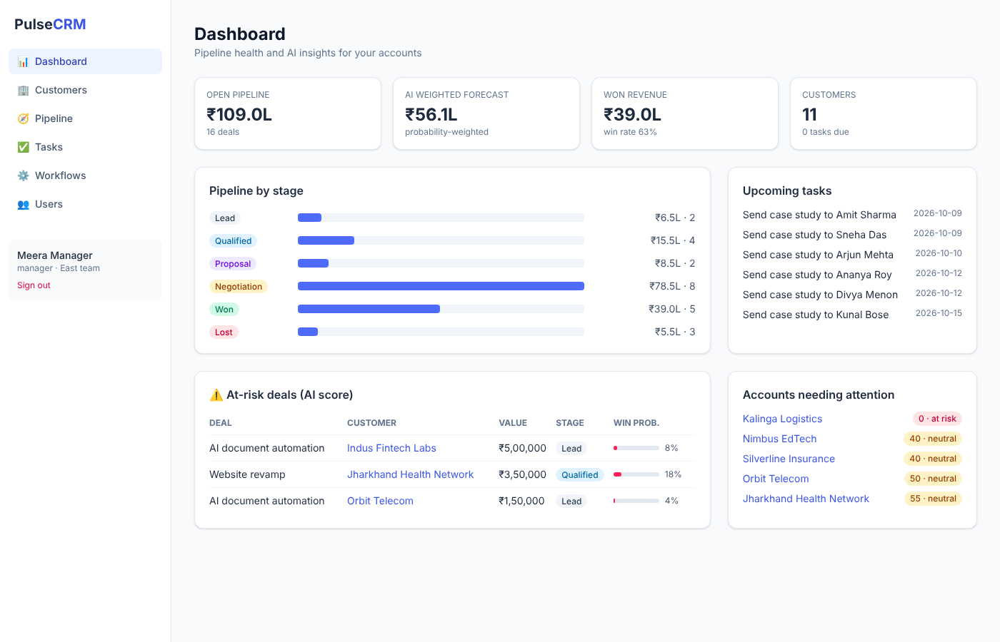
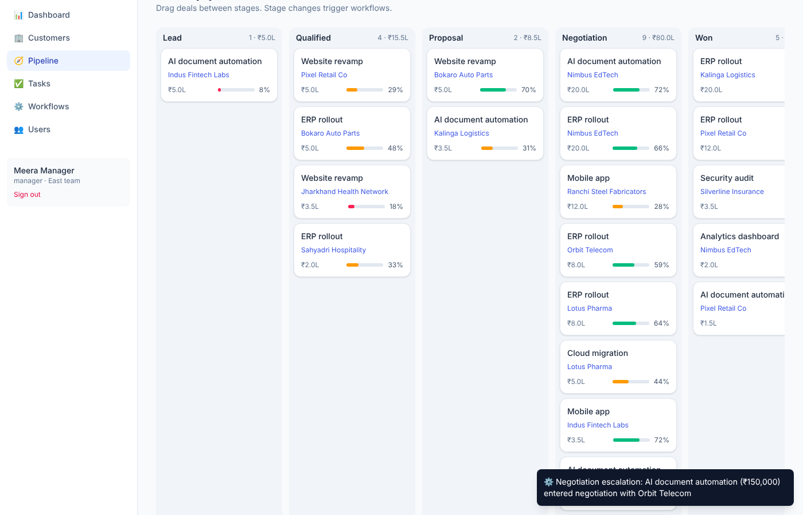
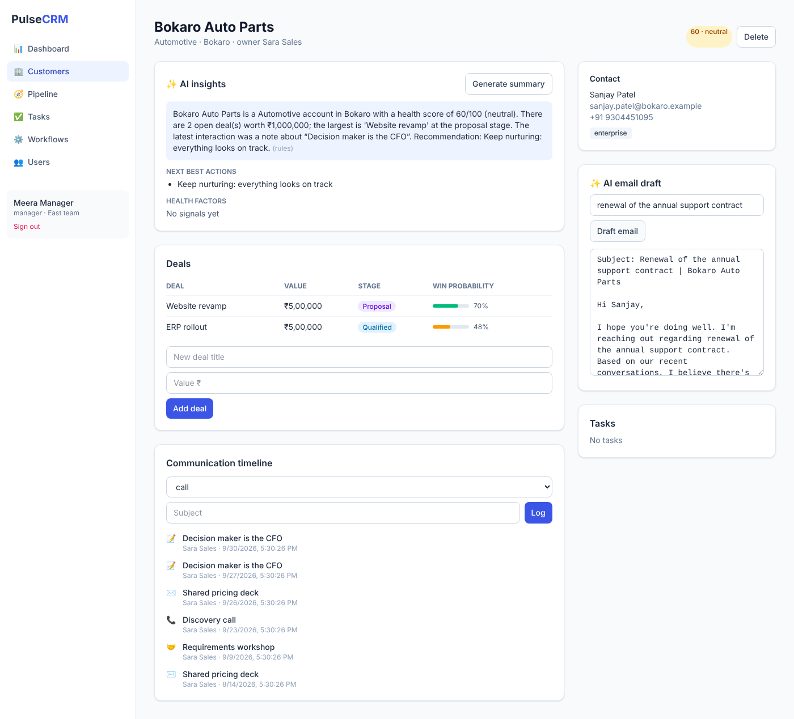

# PulseCRM: AI-Powered CRM (Next.js + Flask + PostgreSQL)

A full-stack CRM with customer records, a drag-and-drop sales pipeline, communication workflows, role-based access control and AI-generated insights.

| Layer | Tech |
|---|---|
| Frontend | Next.js 15 (App Router), React 19, Tailwind CSS 4 |
| API | Flask, Flask-SQLAlchemy, JWT (PyJWT), Flask-CORS |
| Database | PostgreSQL (SQLite fallback for local dev) |
| AI | Transparent scoring models + optional OpenAI for summaries and email drafts |



## Features

- **Customer records**: contacts, industry, tags, owner, open pipeline, health score, full communication timeline.
- **Sales pipeline**: Kanban board across lead → qualified → proposal → negotiation → won/lost with drag and drop.
- **Communication workflows**: configurable "when X then Y" automations. Defaults include a welcome email for new customers, proposal follow-up tasks, manager escalation on negotiation, kickoff tasks on won, loss-feedback tasks, and a stale-deal nudge.
- **Role-based access control** enforced in the API at row level:
  - `admin`: all records, user and role management
  - `manager`: everything owned by their team, delete rights, workflow editing
  - `sales_rep`: only their own customers, deals and tasks
- **AI-generated insights**
  - Deal win probability: logistic model over stage, staleness, engagement, meetings, deal size, overdue close date and customer history. Every factor and its impact is shown in the UI.
  - Customer health score (0-100) with reasons.
  - Next-best-action recommendations.
  - Probability-weighted revenue forecast on the dashboard.
  - Account summaries and email drafts: OpenAI (`gpt-4o-mini`) when `OPENAI_API_KEY` is set, deterministic generator otherwise.

## Screenshots

| Pipeline (drag a deal, workflow fires) | Customer with AI insights |
|---|---|
|  |  |

## Run locally

**API** (port 5005, seeds demo data on first start):

```bash
cd backend
python -m venv .venv && source .venv/bin/activate
pip install -r requirements.txt
python wsgi.py
```

**Web** (port 3000):

```bash
cd frontend
cp .env.example .env.local
npm install
npm run dev
```

Demo users (password `demo1234`): `admin@demo.com`, `manager@demo.com`, `rep@demo.com`, `rep2@demo.com`, `west.rep@demo.com`. Log in as different roles to see RBAC in action.

**Everything with Docker (PostgreSQL included):**

```bash
docker compose up --build      # http://localhost:3000
```

## Tests

```bash
cd backend && pytest -q
cd frontend && npm run build
```

## Deploy

1. **API + Postgres on Render**: *New > Blueprint* with this repo (`render.yaml` creates the database and API). Set `CORS_ORIGINS` to your Vercel URL.
2. **Frontend on Vercel**: import the repo, set **Root Directory** to `frontend`, add `NEXT_PUBLIC_API_URL=https://<your-api>.onrender.com`, deploy.

## API overview

| Endpoint | Notes |
|---|---|
| `POST /api/auth/login` | returns JWT |
| `GET /api/dashboard` | KPIs, stage totals, forecast, at-risk deals, unhealthy accounts |
| `GET/POST /api/customers`, `GET/PATCH/DELETE /api/customers/:id` | detail includes deals with scores, health, next actions |
| `GET /api/customers/:id/insights`, `POST /api/customers/:id/email-draft` | AI text |
| `GET/POST /api/deals`, `PATCH/DELETE /api/deals/:id` | stage changes fire workflows |
| `POST /api/activities`, `GET/POST/PATCH /api/tasks` | timeline and tasks |
| `GET/POST/PATCH /api/workflows`, `POST /api/workflows/run-stale` | automation |
| `GET/POST/PATCH /api/users` | admin |

## Author and contributors

- **Sandeep Kashyap** ([@sktut](https://github.com/sktut)), author and maintainer
